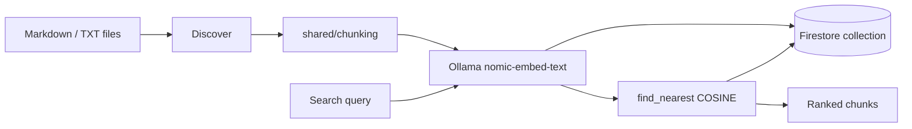

# Architecture

```
workspace-rag/
├── shared/                 # Shared library (both builds)
│   ├── chunking.py         # Markdown-aware token chunking
│   ├── embeddings.py       # Ollama embed calls
│   └── store/
│       └── firestore.py    # Firestore vector CRUD + KNN search
├── internal/               # Gnomad-only
│   ├── config.py           # ORGANIZATION paths, doc types, VAULT exclusions
│   ├── discover.py         # Domain-aware document discovery
│   ├── indexer.py
│   ├── query.py
│   ├── watcher.py
│   ├── cli.py
│   └── firebase/setup-index.sh
└── external/               # Distributable product
    ├── config.yaml         # User workspace + collection
    ├── discover.py         # Generic folder walk
    ├── indexer.py
    ├── cli.py
    └── ROADMAP.md
```

## Data flow



## Collection separation

| Build | Default collection | Indexed scope |
|-------|-------------------|---------------|
| Internal | `workspace_rag_internal` | ORGANIZATION domains 01–05 + SKILL_LIBRARY |
| External | `workspace_rag_external` | User-defined folder via config.yaml |

Both can live in one Firebase project without collision.

## Agent integration (internal)

Swarm agents should call `python internal/cli.py search "..."` or import `internal.query.search()` directly. Planned: `RAG_QUERY` skill in gnomad-swarm-core.

## Re-index behavior

- **Per-file**: delete existing chunks by `source_path`, then upsert new chunks (no duplicates).
- **Full index**: same per-file logic; does not wipe unrelated files.
