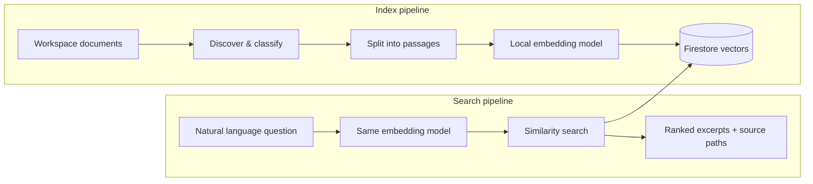

# Workspace RAG — Human Guide

> **Semantic memory for a multi-project digital studio**  
> Portfolio overview for executives, stakeholders, and technical leads.

---

## Executive summary

**Workspace RAG** is Gnomad Studio’s institutional memory system. It indexes thousands of markdown and text documents across web design, AI engineering, finance, business operations, and applications — then makes that knowledge **searchable by meaning**, not just filename.

Instead of agents and humans manually hunting through 100+ project folders, they ask a natural-language question and receive ranked excerpts from the most relevant SOPs, client briefs, skills, and decision records.

**Why it exists:** Gnomad Studio operates as a hub-and-spoke model — many isolated projects, one orchestrator. Without a shared memory layer, every new task starts from zero: duplicated research, inconsistent procedures, and slow context gathering. RAG turns documented knowledge into a reusable asset.

**Privacy posture:** Document text is embedded **locally** via Ollama. Only vector representations and metadata are stored in Firebase Firestore — aligned with the stack Gnomad already uses for client work. Sensitive vault content is **never indexed**.

---

## Business outcomes

| Outcome | What changes |
|---------|--------------|
| **Faster onboarding** | New team members and AI agents find existing SOPs, briefs, and decisions in seconds |
| **Consistent delivery** | Agency workflows and brand standards surface automatically during client work |
| **Reduced rework** | Prior solutions (“how we handled Firebase auth”, “nonprofit site checklist”) are discoverable cross-project |
| **Lower AI cost & noise** | Agents query targeted excerpts instead of loading entire repositories into context |
| **Audit-friendly knowledge** | Indexed content is structured with domain, project, and document-type metadata |

---

## What gets indexed

The internal build indexes the Gnomad **ORGANIZATION** workspace:

| Scope | Included |
|-------|----------|
| **Domains** | `01_web_design`, `02_ai_engineering`, `03_admin_finance`, `04_business_ops`, `05_apps_and_extensions`, `SKILL_LIBRARY` |
| **File types** | `.md`, `.txt` |
| **Document classes** | SOPs, agent directives, skills, decisions, client briefs, proposals, READMEs, chronicler/handoff docs |

| Scope | Excluded (by design) |
|-------|----------------------|
| **Secrets** | `VAULT/` — API keys, credentials, financial records |
| **Legacy** | `06_archive/` |
| **Build artifacts** | `node_modules`, `.next`, `dist`, `.git`, etc. |
| **Transient session files** | Live session state (too volatile to index meaningfully) |

---

## How it works (non-technical)



1. **Discover** — Walk configured workspace folders; classify each file (SOP, skill, client brief, etc.).
2. **Chunk** — Split documents at markdown headings into ~500-token passages with overlap, preserving context.
3. **Embed** — Convert each passage to a 768-dimensional vector using Ollama (`nomic-embed-text`) on the local machine.
4. **Store** — Save vectors and metadata in Firestore with native vector search indexes.
5. **Query** — Embed the user’s question, find nearest vectors (cosine similarity), return ranked passages with source file paths.

A background **file watcher** can keep the index synchronized as documents are edited — no full re-index required for every save.

---

## Technology stack

| Layer | Technology | Rationale |
|-------|------------|-----------|
| **Embeddings** | Ollama + `nomic-embed-text` (768d) | Local, private, no per-token cloud cost |
| **Vector database** | Firebase Firestore native vector search | Same platform as Gnomad client projects; managed scaling; pre-filter support |
| **Indexer & CLI** | Python, Click, Rich | Fast iteration; shared core between internal and product builds |
| **File watching** | watchdog | Delta re-index on create/modify/delete |
| **Chunking** | tiktoken + markdown-aware splitting | Respects document structure; consistent token sizing |

### Dual-build architecture

The repository ships two products on one shared core:

| Build | Audience | Collection |
|-------|----------|--------------|
| **Internal** | Gnomad agent swarm | `workspace_rag_internal` |
| **External** | Future distributable product (any folder) | `workspace_rag_external` |

Both use the same chunking, embedding, and Firestore modules in `shared/` — reducing maintenance and enabling a future SaaS offering.

---

## When to use RAG (humans)

Use semantic search when the question is about **what the organization already knows**:

- “What’s our process for nonprofit client websites?”
- “Have we documented Firebase security rules for production?”
- “What did we decide about deployment branches?”
- “Find prior research on a specific market or niche.”

Use **direct file access** instead when you already know the exact path, need line-level edits, or are working with code (`.ts`, `.py`, etc.) — RAG indexes prose documentation, not source code.

Use **`WORKSPACE.md` and project maps** when you need to **locate** which subfolder owns a project — RAG finds knowledge *inside* projects; maps tell you *where* projects live.

---

## Getting started

### Prerequisites

- Python 3.10+
- [Ollama](https://ollama.com/) with `nomic-embed-text` pulled
- A Firebase project with Firestore enabled
- Service account JSON with Firestore access

### Setup

```bash
cd 02_ai_engineering/workspace-rag
pip install -r requirements.txt
cp .env.example .env
# Edit .env: FIREBASE_PROJECT_ID, GOOGLE_APPLICATION_CREDENTIALS

ollama pull nomic-embed-text
export FIREBASE_PROJECT_ID=your-project-id
./internal/firebase/setup-index.sh   # Creates vector index (one-time)
```

### Commands

```bash
# Full index of workspace documents
python internal/cli.py index

# Semantic search
python internal/cli.py search "Firebase deployment checklist"
python internal/cli.py search "nonprofit SOP" --domain 04_business_ops
python internal/cli.py search "agent directives" --type agent_directive

# Index health
python internal/cli.py status

# Keep index fresh (runs until Ctrl+C)
python internal/cli.py watch
```

### CLI options (search)

| Flag | Purpose | Example |
|------|---------|---------|
| `--domain`, `-d` | Limit to workspace domain | `--domain 01_web_design` |
| `--type` | Limit to document class | `--type sop` |
| `--project`, `-p` | Limit to subfolder under domain | `--project gnomad-swarm-core` |
| `--limit`, `-n` | Max results (default 10) | `-n 5` |
| `--threshold`, `-t` | Similarity floor 0–1 (default 0.7) | `-t 0.75` |

---

## Security & compliance

- **Vault isolation:** Paths containing `VAULT` are excluded at discovery time — secrets never enter the index.
- **Local embeddings:** Raw document text is sent to local Ollama only during indexing and query embedding — not to a third-party embedding API.
- **Credentials:** Service account keys live in `.env` and are never committed. See `.env.example` for required variables.
- **Archive exclusion:** Legacy content in `06_archive` is out of scope — prevents stale or deprecated guidance from ranking highly.

---

## Operational status (reference)

The internal index targets the full Gnomad ORGANIZATION tree. Typical corpus size is **7,000+ vector chunks** across web design, AI engineering, finance, and business ops domains. Run `python internal/cli.py status` for live counts.

---

## Roadmap & product vision

**Today:** Internal CLI + watcher powering the Gnomad agent swarm — query before execute.

**Near term:** Formal `RAG_QUERY` skill integration in gnomad-swarm-core; background indexing on MSI worker for large re-index jobs.

**External product** (`external/`): Configurable semantic search for any document folder — CLI MVP today; desktop app and optional cloud-embedding SaaS tier on the roadmap. See [external/ROADMAP.md](../external/ROADMAP.md).

---

## Related documentation

| Document | Audience |
|----------|----------|
| [AI Agent Guide](./AI_AGENT_GUIDE.md) | AI agents — when/how to query, filters, anti-patterns |
| [Architecture](./ARCHITECTURE.md) | Engineers — repo layout and data flow |
| [Stack & scaling](./STACK.md) | Engineers — cost model, scaling paths, Firebase vs Supabase decision |
| [Project SOP](../.agents/PROJECT_SOP.md) | Operators — setup, troubleshooting |

---

## Portfolio talking points

Use these when presenting the project to stakeholders:

1. **Problem:** A 100+ project studio cannot scale human or AI throughput if every task requires manual filesystem archaeology.
2. **Approach:** Private local embeddings + managed vector search on infrastructure the studio already operates (Firebase).
3. **Differentiator:** Domain-aware classification (SOP vs brief vs skill) and explicit exclusion of secrets — not a naive “index everything” dump.
4. **Impact:** Agents and staff retrieve institutional knowledge in seconds; documented decisions compound instead of expiring in forgotten folders.
5. **Extensibility:** Shared core supports an internal swarm tool today and a distributable product tomorrow.

---

*Gnomad Studio — Workspace RAG · Internal build · `02_ai_engineering/workspace-rag`*
